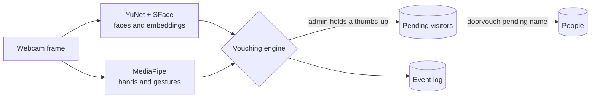

# DoorVouch

[](https://github.com/BrunodePauloAlmeida/doorvouch/actions/workflows/ci.yml)

A camera at your front door that learns who your guests are when you give it a thumbs-up.

DoorVouch is a local-first assistant for the main entrance of a home. It recognises the
people who live there, and it lets a trusted person introduce a newcomer with a gesture:
an admin who arrives with a first-time visitor gives the camera a thumbs-up, and the
visitor is pre-registered on the spot. The admin gives the visitor a name later.

Everything runs on your own computer. No account, no cloud, no video leaving the house.

> **Status: V0 (0.1.0), a concept validation.** It implements one rule end to end. The
> rule passes its unit tests and tests that run the real models on sample photos, on
> Linux and Windows. Measuring it in front of a real camera is the step still open (see
> [Measuring V0](#measuring-v0)). It does not send alerts yet and it is not a security
> product. See [Limitations](#limitations) and the [roadmap](docs/roadmap.md).

## Why

Home cameras tend to do one of two things: alert on every movement, or label only the
faces you already tagged in an app. Adding a person means stopping what you are doing
and opening that app.

DoorVouch moves that step to the door and makes it explicit. A hand gesture is a
deliberate, visible signal from a person the system already trusts, so it can carry
meaning that a face alone cannot: *this person is with me*. Later versions use the same
signal to cancel an alert, and its absence to raise one (see the roadmap).

## How the rule works



1. Every face in view is compared with the enrolled people and with the visitors who
   are waiting for a name.
2. A thumbs-up counts only when the hand belongs to the face of an admin. If it is not
   clear whose hand it is, the gesture is ignored.
3. When an admin has held the thumbs-up for five frames in a row, every clearly unknown
   face in view becomes a *pending visitor*: a face embedding and a small snapshot,
   waiting for a name.
4. A face that is neither a clear match nor clearly new is left alone, so that a known
   person seen at a bad angle does not become a duplicate.

Unknown faces are never stored unless an admin vouches for them.

## Quick start

You need a webcam and [uv](https://docs.astral.sh/uv/). uv installs the right Python
(3.12 or newer) by itself, and the model files take about 50 MB. DoorVouch is written to
run on Windows, macOS and Linux.

On Linux, OpenCV and MediaPipe also need the system's OpenGL libraries. On Debian or
Ubuntu: `sudo apt install libgl1 libegl1 libgles2`.

Open a terminal and run:

```sh
git clone https://github.com/BrunodePauloAlmeida/doorvouch.git
cd doorvouch
uv sync                                   # install DoorVouch and its dependencies
uv run doorvouch models download          # fetch the three model files
uv run doorvouch doctor                   # check packages, models and camera
uv run doorvouch enroll --name "Your Name" --admin
uv run doorvouch run
```

With `run` showing the preview window, stand in view together with somebody who is not
enrolled and hold a thumbs-up in front of your own chest for about a second. The
terminal prints `Your Name vouched for a visitor: pending #1 created`. Press `q` to stop.

Then give the visitor a name:

```sh
uv run doorvouch pending                  # list the visitors waiting for a name
uv run doorvouch pending name 1 "Carol"
uv run doorvouch events                   # what happened, newest first
```

The next time Carol is in view she is recognised by name.

If something does not work, `uv run doorvouch doctor` says which part is failing and
what to do about it.

## Commands

| Command | What it does |
| :--- | :--- |
| `doorvouch doctor` | Checks Python packages, model files, both networks and the camera. |
| `doorvouch models [status\|download]` | Shows or fetches the model files, verifying size and SHA-256. |
| `doorvouch enroll --name NAME [--admin]` | Captures face samples of one person and saves them. |
| `doorvouch run` | Watches the camera and applies the thumbs-up rule. |
| `doorvouch pending [list\|name ID NAME\|discard ID]` | Lists, names or forgets pending visitors. |
| `doorvouch people [list\|remove ID]` | Lists enrolled people, or deletes one with all their data. |
| `doorvouch events` | Shows the most recent events. |
| `doorvouch trial --scenario vouch\|impostor` | Runs the acceptance trial described below. |

Useful options: `--home DIR` (or the `DOORVOUCH_HOME` variable) chooses where data is
kept, the default being `./data`; `--camera N` picks another camera; `--no-window` runs
without the preview.

## Measuring V0

V0 is done when the rule holds up in front of a real camera, not only in unit tests.
`doorvouch trial` repeats a scenario and counts the outcomes, working on a scratch copy
of the database so that nothing real is changed:

| Scenario | What people do | An attempt passes when | Accepted when |
| :--- | :--- | :--- | :--- |
| `vouch` | An admin and one visitor are in view; the admin gives a thumbs-up. | Exactly one pending visitor is created. | At least 8 of 10 attempts pass. |
| `impostor` | Somebody who is not an admin gives a thumbs-up. | The thumbs-up is seen and ignored. | 10 of 10 attempts pass. |

The protocol and the recorded results are in [docs/v0-acceptance.md](docs/v0-acceptance.md).

## Privacy

DoorVouch handles biometric data, so the defaults are conservative:

- Everything stays in the data folder on your computer. Nothing is uploaded. The only
  network access is `doorvouch models download`.
- An unknown face is not stored. Only an admin's thumbs-up creates a record for a
  visitor, and `doorvouch pending discard` deletes it again.
- `doorvouch people remove` deletes a person together with their face samples and the
  events that mention them.
- The data folder is in `.gitignore`. No real face is part of this repository: the
  tests use synthetic embeddings.

Read [docs/privacy.md](docs/privacy.md) before pointing a camera at other people.

## Models and licences

The models are downloaded on demand and are not part of this repository. Each file is
checked against a pinned size and SHA-256 before it is used.

| Model | Used for | Source | Licence |
| :--- | :--- | :--- | :--- |
| YuNet (`face_detection_yunet_2026may.onnx`) | Face detection | [OpenCV Zoo](https://github.com/opencv/opencv_zoo) | MIT |
| SFace (`face_recognition_sface_2021dec.onnx`) | Face embeddings | [OpenCV Zoo](https://github.com/opencv/opencv_zoo) | Apache-2.0 |
| Gesture Recognizer (`gesture_recognizer.task`) | Hands and the thumbs-up | [MediaPipe](https://ai.google.dev/edge/mediapipe/solutions/vision/gesture_recognizer) | See Google's model card |

Only models with permissive licences are used, which rules out some popular ones. The
reasoning is in [docs/decisions/0001-permissive-models-only.md](docs/decisions/0001-permissive-models-only.md).

## Roadmap

| Stage | Goal | Estimate |
| :--- | :--- | ---: |
| V0 (this release) | One camera, one rule: an admin's thumbs-up pre-registers a visitor. | 8 h |
| MVP | Visits, away mode and a Telegram alert when an unknown person is not vouched for. | 24 h |
| Phase 1 | Harder to fool and harder to silence: liveness, duress gesture, escalation, tamper detection. | 30 h |
| Phase 2 | Usable by a household: web dashboard, several cameras, Home Assistant, Docker. | 34 h |
| Phase 3 | Open platform: event descriptions, hardware acceleration, custom gestures, plugins. | 36 h |

Details, with the tasks and exit criteria of each stage, are in [docs/roadmap.md](docs/roadmap.md).

## Limitations

- The thresholds are starting points taken from the models' documentation. They have
  not been calibrated on real entrances yet.
- There is no liveness check: a printed photo of an admin's face next to a real
  thumbs-up could vouch for a stranger. This is the first item of Phase 1.
- One camera, read from a local webcam. No RTSP, no recording, no alerts.
- Face recognition is less accurate for some groups of people than for others, in poor
  light and at steep angles. Treat every match as a hint, not as proof.

Do not rely on DoorVouch as your only protection.

## Development

```sh
uv run pytest               # tests
uv run ruff check .         # lint
uv run ruff format --check .
uv run mypy                 # strict type check
```

The rule engine (`doorvouch.core`) and the storage (`doorvouch.storage`) use only the
Python standard library, and no module needs OpenCV, MediaPipe or NumPy to be imported.
The tests for the logic therefore run anywhere:

```sh
python -m pip install pytest
python -m pytest
```

Tests that exercise the real libraries are skipped when those are not installed.

`tests/test_real_models.py` goes one step further and runs the real networks on
MediaPipe's public sample photos: a thumbs-up from an enrolled person pre-registers the
other person in the picture, and the same gesture from somebody else is ignored. These
tests need the model files and the photos; the file explains how to get them. CI runs
them on Linux and on Windows.

```text
src/doorvouch/
  core/       the vouching rule: geometry, embeddings, gallery, gestures, engine
  storage/    SQLite: people, face samples, pending visitors, events
  vision/     adapters: OpenCV faces, MediaPipe gestures, camera, preview window
  apps/       live loop, enrollment, acceptance trial, doctor
  cli.py      the `doorvouch` command
docs/         architecture, roadmap, privacy, acceptance protocol, decisions
tests/        unit tests with synthetic data, no camera needed
```

How the pieces fit together is described in [docs/architecture.md](docs/architecture.md).

## License

[MIT](LICENSE).
