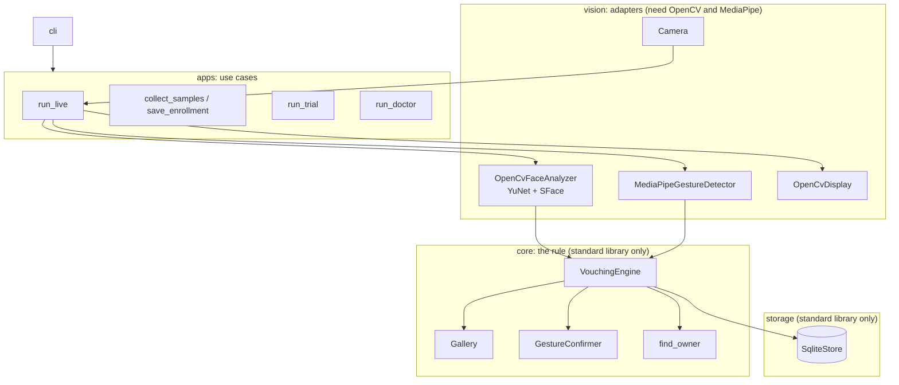

# Architecture

DoorVouch is a small pipeline: frames come in from a camera, two adapters turn each
frame into plain observations (faces and hands), and a rule engine decides what those
observations mean. Everything the engine concludes is written to one SQLite file.

## Layers

| Layer | Package | May import | Responsibility |
| :--- | :--- | :--- | :--- |
| Core | `doorvouch.core` | standard library | The vouching rule and the data it works on. |
| Storage | `doorvouch.storage` | standard library, core | People, face samples, pending visitors, events. |
| Vision | `doorvouch.vision` | core; OpenCV, MediaPipe and NumPy only inside functions | Turning pixels into observations; camera and preview window. |
| Apps | `doorvouch.apps` | everything above | The live loop, enrollment, the acceptance trial, the doctor. |
| CLI | `doorvouch.cli` | everything above | Parsing arguments and printing results. |

Two rules keep the logic testable and are enforced by `tests/test_architecture.py`:

1. `core` and `storage` use only the standard library.
2. No module imports OpenCV, MediaPipe or NumPy at import time. The adapters import
   them inside the functions that need them, so `doorvouch people` or the unit tests
   work on a machine where those packages are not installed.

The reasoning is in [decisions/0003-stdlib-only-core.md](decisions/0003-stdlib-only-core.md).

## What flows through the pipeline

The adapters produce three plain data classes (`core/observations.py`). Nothing after
this point knows about images.

| Type | Fields | Produced by |
| :--- | :--- | :--- |
| `FaceObservation` | bounding box, embedding (unit vector), detection score | `FaceAnalyzer.analyze(frame)` |
| `HandObservation` | centre of the hand, gesture label or `None`, score | `GestureDetector.detect(frame, timestamp)` |
| `FrameObservation` | timestamp, faces, hands | the live loop |

`FaceAnalyzer` and `GestureDetector` are protocols (`vision/base.py`). The tests use
scripted implementations, and another model can be plugged in by writing a class with
the same method.

## The rule

`VouchingEngine.process(observation)` does the following for every frame.

1. **Identify each face.** The embedding is compared with every enrolled sample using
   cosine similarity (`Gallery`). The outcome is one of five statuses:

   | Status | Meaning |
   | :--- | :--- |
   | `admin` | Matches an enrolled person who may vouch. |
   | `known` | Matches an enrolled person who may not vouch. |
   | `pending` | Matches a visitor who is waiting for a name. |
   | `uncertain` | Too similar to somebody enrolled to be called new, not similar enough to be a match. |
   | `unknown` | Clearly nobody the system knows. |

2. **Attribute each thumbs-up.** `find_owner` measures the distance from the hand to
   each face centre in units of that face's width. The nearest face owns the hand,
   unless the hand is out of reach of every face or a second face is almost as near, in
   which case the gesture belongs to nobody. See
   [decisions/0002-gesture-to-face-association.md](decisions/0002-gesture-to-face-association.md).

3. **Confirm the gesture.** `GestureConfirmer` requires the thumbs-up of one admin in
   five consecutive frames, tolerating a one-frame gap, and then fires once. It does not
   fire again for the same sustained gesture, nor within the cooldown.

4. **Vouch.** On confirmation, every face that is not an enrolled person is considered:
   a `pending` face is refreshed, an `uncertain`, blurry or tiny face is skipped with a
   reason, and an `unknown` face becomes a new pending visitor with its embedding and
   a small snapshot.

5. **Log.** Everything worth knowing becomes an event, in memory for the caller and in
   the `events` table.

### Events

| Kind | When |
| :--- | :--- |
| `person_seen` | An enrolled person is in view (at most once per minute per person). |
| `pending_created` | An admin vouched and a new pending visitor was stored. |
| `pending_seen` | An admin vouched for a visitor who was already pending. |
| `visitor_skipped` | An admin vouched but the face was `uncertain`, too blurry or too small. |
| `vouch_without_visitor` | An admin vouched with no visitor in view. |
| `gesture_ignored` | A thumbs-up had no clear owner, or its owner is not an admin. |
| `person_enrolled` | `doorvouch enroll` saved samples. |
| `pending_named`, `pending_discarded` | A pending visitor was named or forgotten. |

### Thresholds

All of them live in `EngineConfig` (`core/engine.py`). They are starting points to be
calibrated in Phase 1.

| Setting | Default | Meaning |
| :--- | ---: | :--- |
| `match_threshold` | 0.363 | Cosine similarity from which two SFace embeddings are the same person (the value OpenCV documents for SFace). |
| `visitor_max_similarity` | 0.30 | A face is new only below this similarity to everyone enrolled. Between the two values it is `uncertain`. |
| `min_face_width` | 64 px | Smaller faces are not pre-registered. |
| `min_face_score` | 0.8 | Detection confidence needed to pre-register a face. |
| `min_gesture_score` | 0.6 | Classifier confidence needed for a thumbs-up to count. |
| `gesture_frames` / `gesture_gap_frames` | 5 / 1 | Frames the gesture must be held, and frames it may flicker. |
| `gesture_cooldown_seconds` | 3 s | Pause before the same admin can vouch again. |
| `hand_max_reach` | 4.0 | How far a hand may be from its owner's face, in face widths. |
| `hand_ambiguity_ratio` | 0.8 | The nearest face must be closer than this fraction of the runner-up's distance. |

## Storage

One SQLite database in write-ahead-log mode, `<home>/doorvouch.db`, with the schema
version in `PRAGMA user_version`.

| Table | Content |
| :--- | :--- |
| `people` | Name, admin flag, creation time. |
| `face_samples` | One embedding per row (little-endian float32), linked to a person. Deleted with the person. |
| `pending_visitors` | Embedding, snapshot file name, who vouched, how often seen. |
| `events` | Time, kind, person, pending visitor and a JSON detail. |

Snapshots are small JPEG files in `<home>/snapshots`. They exist only while a visitor is
pending: naming or discarding the visitor deletes the file.

The live loop checks `PRAGMA data_version` every two seconds, so a person enrolled or
named from a second terminal is picked up by a running `doorvouch run`.

## Adapters

- **Faces.** YuNet runs on a copy of the frame shrunk to 640 pixels on its longest
  side, because it was trained for faces up to roughly 300 pixels and a face near a
  high-resolution webcam is larger. The detections are scaled back, and SFace computes
  the embedding from the full-resolution frame.
- **Gestures.** MediaPipe's Gesture Recognizer runs in video mode and reports up to
  four hands. The hand's position is the centroid of its 21 landmarks.
- **Camera.** OpenCV's `VideoCapture`, asking for 1280x720 in MJPG. On Windows the
  DirectShow backend is tried first.
- **Windows paths.** OpenCV cannot open a model whose path has accented characters on
  Windows, so in that case the model is loaded from its bytes. MediaPipe always gets
  the bytes.

## Testing

- The rule, the storage and the command line are tested with synthetic embeddings and
  scripted frames. No image of a real person is in the repository.
- The adapters are tested with stand-ins for the networks, plus a few tests that call
  the real OpenCV and MediaPipe when they are installed.
- `tests/test_real_models.py` runs the real networks on MediaPipe's public sample
  photos, composed into scenes with two people. It checks recognition across two photos
  of the same person, the gesture labels, the hand-to-face association and the whole
  rule, down to the snapshot of the pre-registered visitor. Continuous integration
  downloads the models and the photos and runs these tests on Linux and on Windows.
- What no photo can show, the behaviour in front of a real camera, is measured by
  `doorvouch trial` and recorded in [v0-acceptance.md](v0-acceptance.md).
